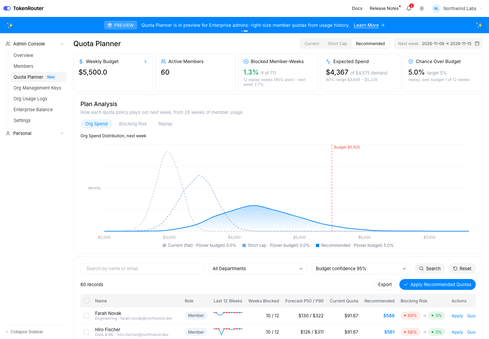

# Quota Planner for PBD TokenRouter (concept)

**Live demo:** https://mohith26.github.io/palebluedot-quota-planner/

An unofficial concept feature for [PBD TokenRouter](https://www.tokenrouter.com) by PaleBlueDot AI, built by Mohith Gajjela. Not affiliated with PaleBlueDot AI or TokenRouter. All data is synthetic.



## What it is

TokenRouter's Enterprise Edition lets admins give every member a fixed, weekly or monthly quota. Today the admin picks those numbers by hand. Most orgs end up with one flat number, which is wrong in both directions: light users never touch theirs, while the engineers running coding agents hit the wall by Wednesday.

**Quota Planner** is a new page in the Admin Console (next to Members) that recommends each member's quota for next week from their usage history, so that:

- the org's spend stays under its weekly budget with a chosen confidence (95% by default), and
- as little real demand as possible hits a quota wall.

## Results on the demo org (seed 20261109, next week = Nov 9 2026)

Northwind Labs (synthetic): 60 members in Engineering, Data & ML, Product & Design, Support & Ops; 26 weeks of usage; weekly budget $5,500; current policy is a flat $91.67 per member.

Replay over the last 12 weeks: every policy is deployed from Aug 17 and scored against the simulator's true demand, refitting each week on what that policy itself would have observed.

| Policy | Blocked member-weeks | Demand left unserved | Weeks over budget |
|---|---|---|---|
| Current flat quota ($91.67) | **27.0%** (192 of 711) | $19,661 | 0 of 12 |
| Strict cap (quotas sum to the budget) | 27.0% (192 of 711) | $14,231 | 0 of 12 |
| **Recommended (95% budget confidence)** | **1.3%** (9 of 711) | **$1,931** | 1 of 12 |

Under flat quotas the org spends a median $2,984 of its $5,500 budget while a quarter of member-weeks are blocked. The recommended quotas add up to $17,096, but because members rarely peak in the same week, the model puts the chance of org spend exceeding $5,500 at 5.0%. Member-level 80% forecast intervals covered 77.5% of true weekly demand in the replay.

## How it works

1. **Censored demand model.** Weekly spend for a member is 0 with probability p0 (PTO, no use) or lognormal. A week that hit the quota is **right-censored**: the true demand was at least the quota. Parameters (level, adoption trend, spread) are fit by EM for a Tobit model on the log scale, recency-weighted (half-life 12 weeks). Treating blocked weeks as real demand would bias the heavy users low, which is exactly the population quotas matter for.
2. **Pooling.** Each member's level is shrunk toward their department (empirical Bayes, two passes), the adoption trend toward 0 (prior sd 2%/week), and the spread toward the department median. New members borrow their department's behavior.
3. **Heavy tails.** Agent runs and batch jobs make weekly spend far more right-skewed than a lognormal. Next-week draws resample standardized residuals from members who almost never hit their quota (their visible weeks are complete), so the tail is empirical, not assumed.
4. **Allocation.** Minimize total expected demand above quota, sum of E[(D_i - q_i)+], subject to a budget constraint. The optimality condition is that every member gets the same probability of hitting their quota, so the solver is a one-dimensional bisection on that probability.
   - *Strict cap:* sum of quotas <= budget, so spend can never exceed it.
   - *Recommended:* P(sum of min(D_i, q_i) > budget) <= alpha, checked on 4,000 joint scenarios. This is overbooking: quotas can add up to more than the budget because members don't all peak in the same week.
5. **Replay.** Sequential, per policy: each policy's own observed history (censored at its own quotas) feeds its next fit, scored against simulator truth.

Everything on the page is computed in the browser by `core/quota.js` from the seeded simulator; nothing is hard-coded.

## Does it hold up? (`node scripts/validate.mjs`)

```
seed 1: blocked member-weeks flat 23.6% | strict cap 24.5% | planner 3.3% | unserved $21587 -> $3377 | over budget 0/12 weeks | 80% interval coverage 77.1%
seed 2: blocked member-weeks flat 28.7% | strict cap 31.1% | planner 7.5% | unserved $31662 -> $7350 | over budget 3/12 weeks | 80% interval coverage 76.7%
seed 3: blocked member-weeks flat 27.8% | strict cap 34.4% | planner 15.3% | unserved $34362 -> $13475 | over budget 0/12 weeks | 80% interval coverage 76.5%
seed 4: blocked member-weeks flat 26.4% | strict cap 29.5% | planner 6.0% | unserved $24298 -> $4413 | over budget 2/12 weeks | 80% interval coverage 76.9%
seed 5: blocked member-weeks flat 24.3% | strict cap 26.0% | planner 2.8% | unserved $24353 -> $3179 | over budget 2/12 weeks | 80% interval coverage 75.5%
seed 6: blocked member-weeks flat 27.4% | strict cap 33.3% | planner 10.2% | unserved $29235 -> $9780 | over budget 0/12 weeks | 80% interval coverage 74.3%
planner over-budget weeks: 7/72 (9.7%, target 5%)
```

## Tests

`node --test test/quota.test.mjs` (8 tests): normal CDF/inverse; the simulator censors exactly at the quota; censored EM recovers the true mean when about 64% of weeks are blocked (and the naive estimate is biased low); a planted adoption trend is detected; empirical helpers; the strict-cap plan sums to the budget and equalizes blocking probability; the 95% plan respects its in-sample risk and beats flat quotas; no random budget-neutral transfer between two members improves the strict-cap objective.

## Honest limitations

- **Synthetic data.** The org, members and demand process are simulated, including the agent-run bursts and adoption ramps.
- **Budget risk is under-estimated.** The plan targets a 5% chance of going over budget, but in replay it went over in 7 of 72 weeks (9.7%) across six simulated orgs. The heavy users' real demand is hidden behind their old quotas, so the model sees less spread than there is. Planning at a stricter target, or learning for a few weeks after raising quotas, narrows the gap; it doesn't close it.
- **Strict cap barely helps blocking.** When quotas must add up to the budget, heavy-tailed demand means you can mainly cut unserved dollars (-28% here), not blocked weeks. The win comes from overbooking.
- **Weekly granularity.** No intra-week timing (when a member gets blocked), no per-model quotas, no department pools.
- **Equal weights.** Every dollar of blocked demand counts the same; a real admin might weight members or teams.

## Novelty note

TokenRouter's feature guide, blog and console screenshots describe manual quota allocation (fixed, weekly or monthly), "Add Quota" / "Batch Add Quota" on Members, usage analytics and logs. Comparable gateways (Portkey usage-limit policies, Cloudflare AI Gateway spend limits, Coder AI Gateway group budgets, Cequence budgets, LiteLLM budgets) also take hand-set numbers. I found no gateway that recommends per-member quotas from usage history, accounts for censoring at the old quota, or overbooks quotas against an org-level budget risk.

## Files

- `index.html`, `style.css`, `app.js`: the page (static; Inter from Google Fonts and Lucide icons from a CDN).
- `core/quota.js`: simulator, censored model, predictive draws, allocation, replay.
- `test/quota.test.mjs`, `scripts/generate.mjs`, `scripts/validate.mjs`; `data/` holds the generated org and summary.
